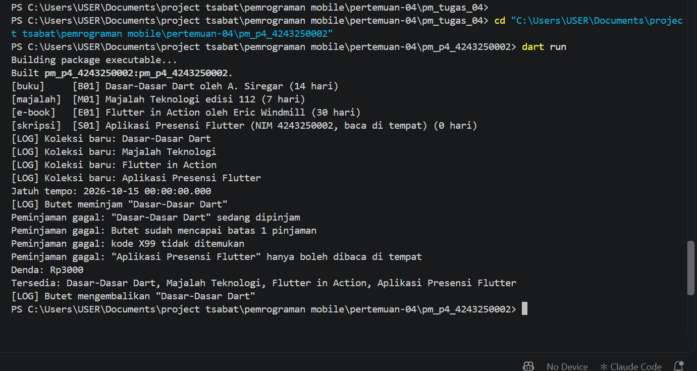

# Praktikum Pertemuan 4 — OOP Library System

Pemrograman Mobile (3KOM40215) · Pertemuan 4 · Ilmu Komputer UNIMED

| | |
|---|---|
| Nama  | Muhammad Tsabat Muhyiyuddin |
| NIM   | 4243250002 |
| Kelas | PSIK24D |
| GitHub | [tsabat15](https://github.com/tsabat15) |

## Cara menjalankan

```
dart run                             # sistem perpustakaan
dart run contoh/a9a_future.dart      # contoh dari Bagian A
```

`contoh/a1_class.dart` sengaja berakhir dengan error karena setter `ipk` diuji dengan nilai 5, sesuai Lembar Kerja.

## Isi repository

- `lib/model.dart`, `lib/perpustakaan.dart`, `bin/pm_p4_4243250002.dart`: sistem perpustakaan.
- `contoh/`: Contoh A.1, A.1b, A.3, A.5, A.6, A.9a, A.9b, A.10a, A.10b, dan A.11.
- `dokumen/`: Lembar Kerja Praktikum (C) dan Latihan Mandiri (E).

## Tantangan yang dikerjakan

1. Model dipindah ke `lib/model.dart` dan layanan ke `lib/perpustakaan.dart`. Akses `k._dipinjam` dari berkas lain menjadi error karena `_` bersifat privat terhadap berkas. Perbaikannya: method publik `tandaiDipinjam()` dan `tandaiKembali()`.
2. Kelas `Skripsi extends Koleksi` hanya boleh dibaca di tempat; peminjamannya ditolak dengan `PeminjamanGagal`.
3. `Koleksi` menjadi `sealed class` dengan fungsi `ikon(Koleksi k)`. Bila satu subtipe tidak ditulis di `switch`, compiler menolak dengan error *non-exhaustive*.

## Contoh keluaran



Teks keluarannya:

```
[buku]     [B01] Dasar-Dasar Dart oleh A. Siregar (14 hari)
[majalah]  [M01] Majalah Teknologi edisi 112 (7 hari)
[e-book]   [E01] Flutter in Action oleh Eric Windmill (30 hari)
[skripsi]  [S01] Aplikasi Presensi Flutter (NIM 4243250002, baca di tempat) (0 hari)
[LOG] Koleksi baru: Dasar-Dasar Dart
[LOG] Koleksi baru: Majalah Teknologi
[LOG] Koleksi baru: Flutter in Action
[LOG] Koleksi baru: Aplikasi Presensi Flutter
Jatuh tempo: 2026-10-15 00:00:00.000
[LOG] Butet meminjam "Dasar-Dasar Dart"
Peminjaman gagal: "Dasar-Dasar Dart" sedang dipinjam
Peminjaman gagal: Butet sudah mencapai batas 1 pinjaman
Peminjaman gagal: kode X99 tidak ditemukan
Peminjaman gagal: "Aplikasi Presensi Flutter" hanya boleh dibaca di tempat
Denda: Rp3000
Tersedia: Dasar-Dasar Dart, Majalah Teknologi, Flutter in Action, Aplikasi Presensi Flutter
[LOG] Butet mengembalikan "Dasar-Dasar Dart"
```

## Pernyataan penggunaan AI

Saya menggunakan asisten AI untuk membantu menyalin dan menguji kode modul, mengerjakan tantangan, dan menyusun README ini. Saya bertanggung jawab memahami seluruh isinya.
